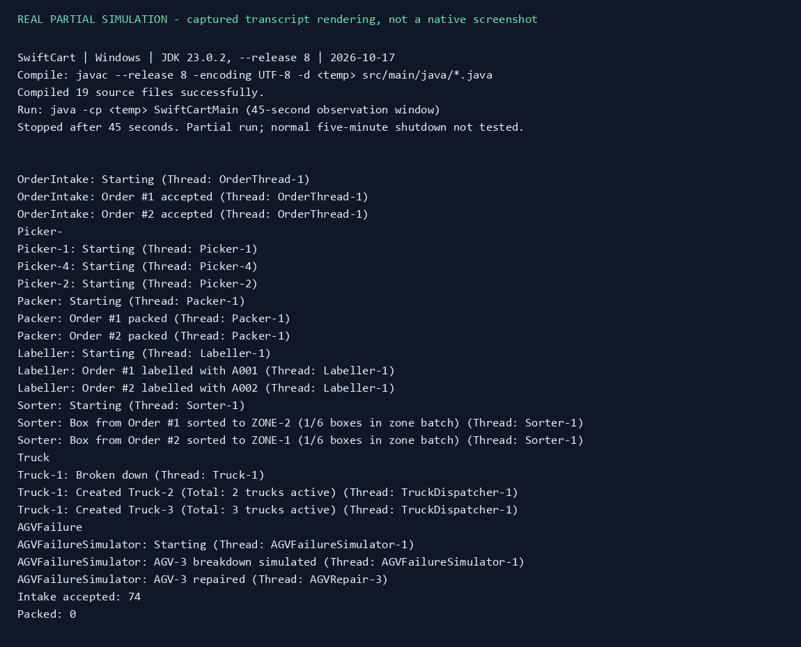
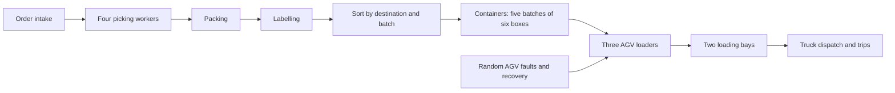

# SwiftCart Warehouse Automation Simulator

A Java concurrency coursework project that models an e-commerce warehouse: synthetic orders move through picking, packing, labelling, sorting, AGV loading and truck transport. Its value is the coordination of multiple worker threads and limited shared resources, rather than integration with a real warehouse.

The original project credits **Faiyad Mahabub** for the Concurrent Programming module. The [preserved project guide](docs/PROJECT_GUIDE.md) retains the original coursework context and component overview.

**Status:** all Java sources compile with the Java 8 language/API target. A real 45-second partial run demonstrated active pipeline stages using the unchanged default configuration. The five-minute completion path and final aggregate report were not verified in this run.



*Rendering of excerpts captured from a real local simulation on 17 October 2026, not a native terminal screenshot. Inputs, delays, failures and quality outcomes are synthetic and randomized. [Captured transcript](docs/assets/smoke-transcript.txt).*

## Pipeline and concurrency



`BlockingQueue` transfers work between stages. Semaphores constrain AGVs, loading bays and containers at the bay; atomic counters record shared activity. Dedicated rejection, fault simulation and shutdown threads support the processing workers.

Defaults in `Constants.java` are 600 generated orders, a 500 ms intake interval, four pickers, three AGVs, two bays, six-box batches and 30-box containers. Quality rejection probability is 10% at relevant checks, and AGV fault probability is 5% at its periodic checks. These are simulation parameters, not measured warehouse reliability.

## Build and run

Requires a JDK with `javac` and `java` on PATH; no external Java dependencies. Verification used JDK 23.0.2 with `--release 8`. From the repository root in PowerShell:

```powershell
New-Item -ItemType Directory -Force target/classes | Out-Null
javac --release 8 -encoding UTF-8 -d target/classes (Get-ChildItem src/main/java/*.java).FullName
java -cp target/classes SwiftCartMain
```

The default simulation runs for at least five minutes plus intake completion and pipeline drain/shutdown. Intake verification adds work beyond the nominal 500 ms sleep, so 600 orders need not finish in exactly five minutes. Console messages expose worker activity; there is no graphical UI or persistent warehouse database.

`pom.xml` also declares the Java 8 compiler target, but its `exec.mainClass` points to an absent packaged class. The verified entry point is the default-package `SwiftCartMain` shown above.

To reproduce the bounded evidence without changing source or constants, use Python 3.10+:

```powershell
python -B scripts/smoke.py
```

The helper compiles into a temporary directory, runs the real entry point for 45 seconds, then terminates that observation run. It retains a compact selection of actual log lines and counts matching events. These are observations of a partial random run, not end-to-end correctness tests or throughput benchmarks. [Exact verification](docs/VERIFICATION.md).

## Limits of the model

The `LinkedBlockingQueue` instances have no explicit capacity; queue transfer alone does not enforce bounded backpressure. Shutdown waits for intake, then uses bounded drain waits and interruption, so a successful launch does not establish lossless completion or freedom from deadlock in every schedule.

Final statistics contain assumptions: received orders are hard-coded to 600 in shutdown aggregation, and stage rejection counts are distributed from the total rather than collected independently. Keep these separate from direct event counts. Random seeds are not controlled, so different runs produce different outcomes.

The [detailed guide](docs/PROJECT_GUIDE.md) describes the components and learning goals, with corrections noted at its start. No automated test suite or standalone license file is present; no production readiness or industrial performance claim is made.
